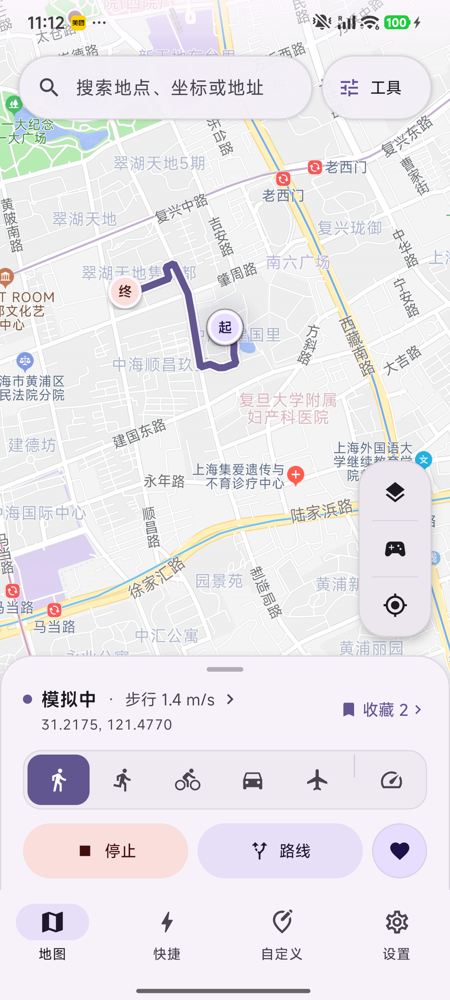
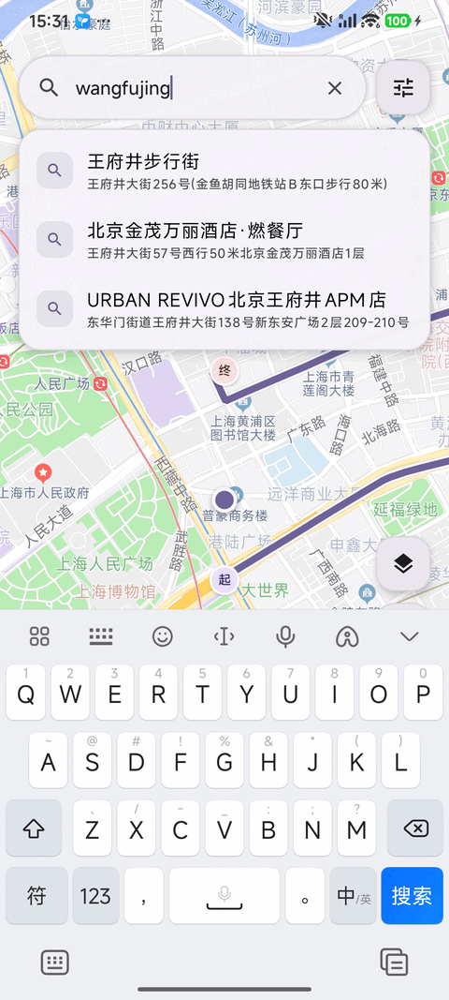
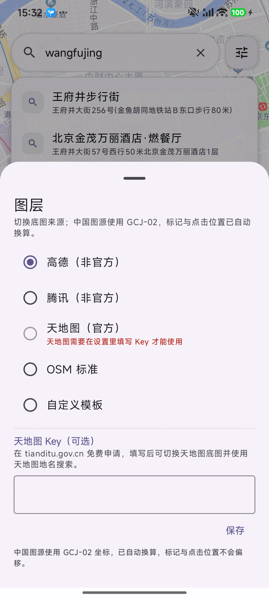
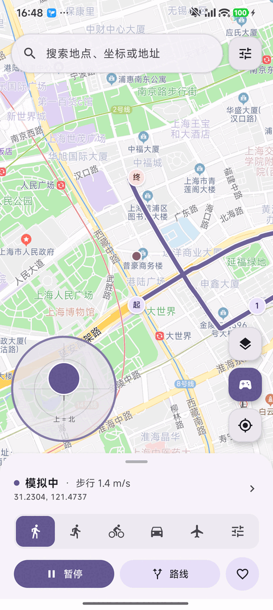
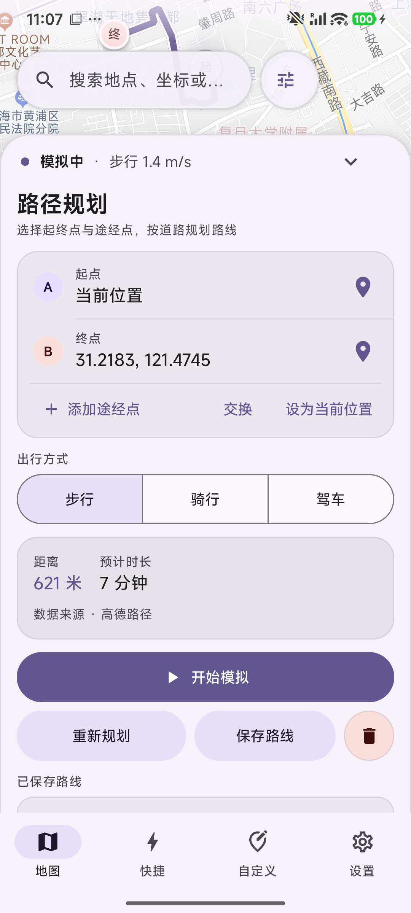
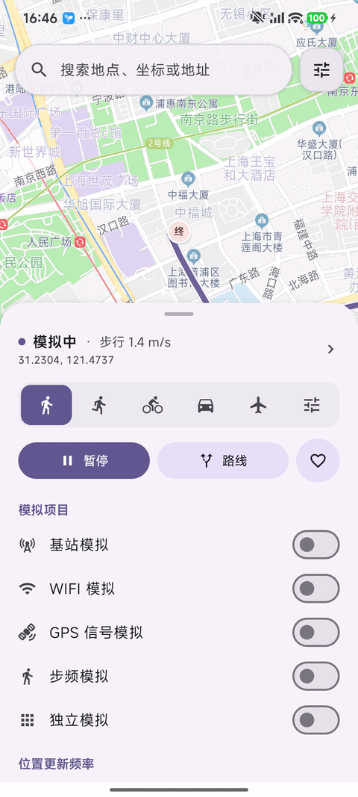
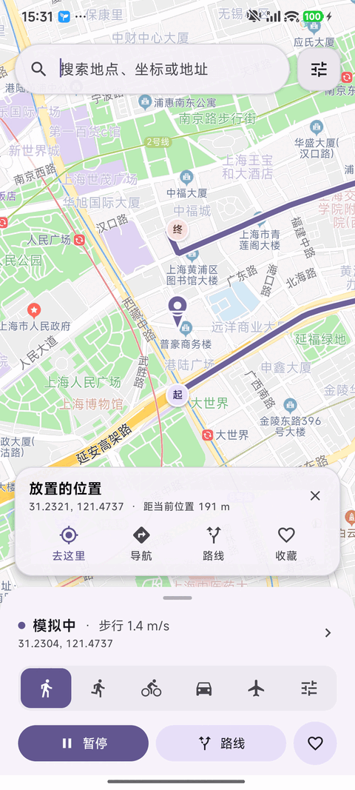
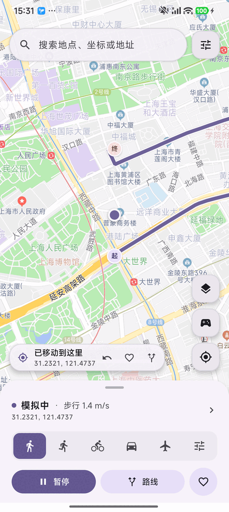
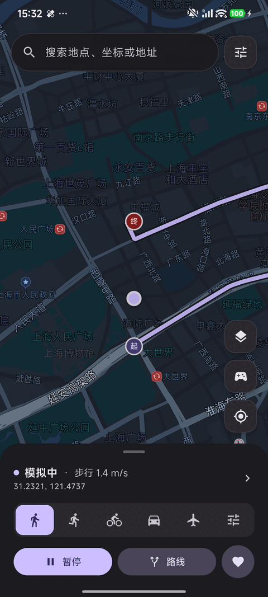

<h1 align="center">
  
  ImmoralLocation
</h1>

<table align="center">
  <tr>
    <td align="center"></td>
    <td align="center"></td>
  </tr>
  <tr>
    <td align="center"></td>
    <td align="center"></td>
  </tr>
  <tr>
    <td align="center"></td>
    <td align="center"></td>
  </tr>
  <tr>
    <td align="center"></td>
    <td align="center"></td>
  </tr>
</table>

<h3 align="center">LSPosed 位置模拟器 · Android 8.1+</h3>

  

