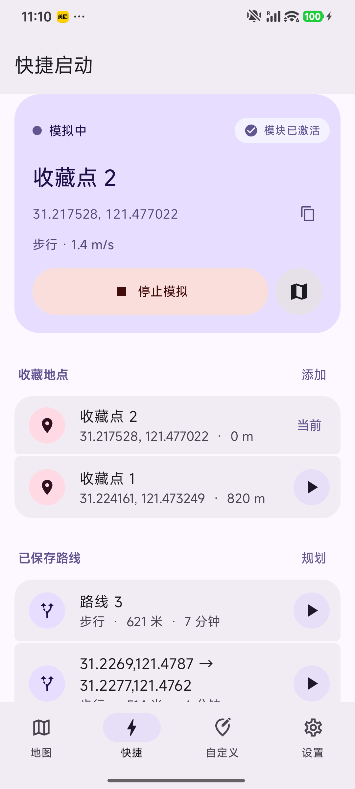
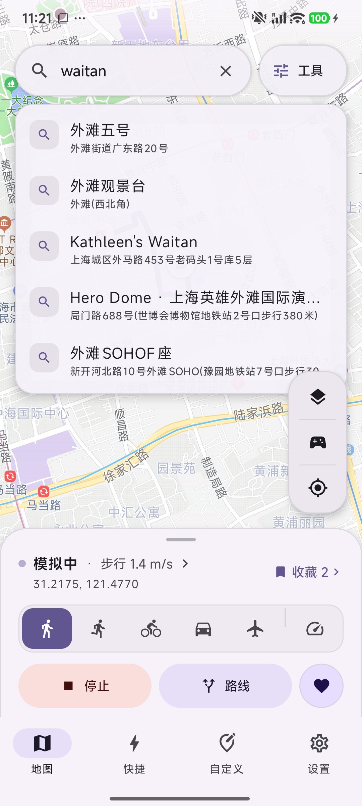
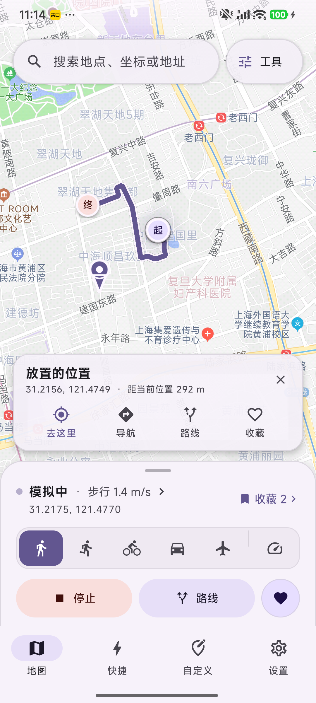
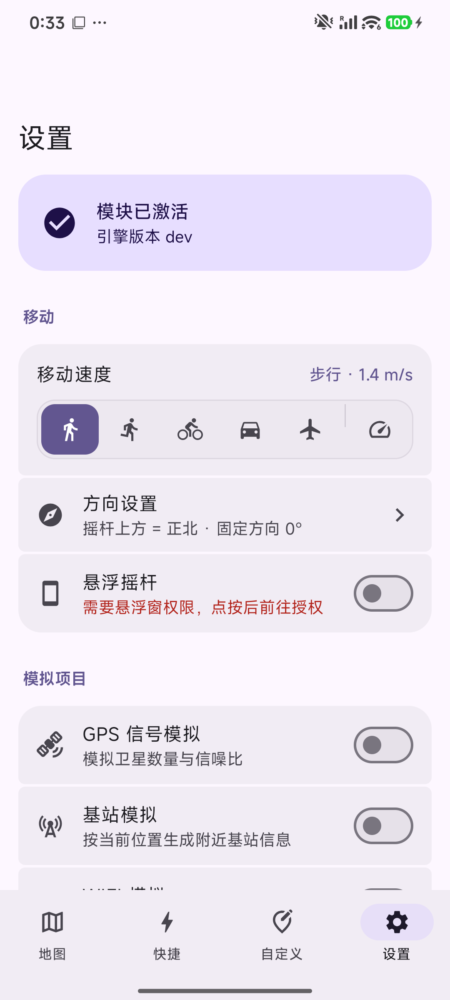
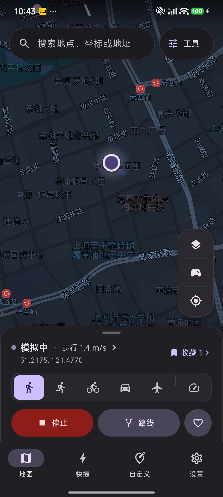

<h2 align="center">
  ImmoralLocation
</h2>

<h5 align="center">LSPosed 虚拟定位</h5>

  

<h6 align="center">
本程序仅需注入 system & com.android.phone，对目标 APP 透明，不要在模块作用域内勾选目标 APP
<h6>

<table align="center">
  <tr>
    <td align="center"></td>
    <td align="center"></td>
  </tr>
  <tr>
    <td align="center"></td>
    <td align="center"></td>
  </tr>
  <tr>
    <td align="center"></td>
    <td align="center"></td>
  </tr>
  <tr>
    <td align="center"></td>
    <td align="center"></td>
  </tr>
</table>

<h6>
本程序仅供学习研究、技术交流以及个人合法合规测试（如开发者定位测试、设备兼容性调试）使用。 使用者请勿将本工具用于任何违法违规或违反相关平台服务协议的活动（包括但不限于虚假打卡、网络考试作弊、商业欺诈等）。 使用本模块造成的任何账号封禁、数据丢失、法律纠纷或其他直接/间接损失，均由使用者自行承担，作者不对此承担任何责任。
<h6>
